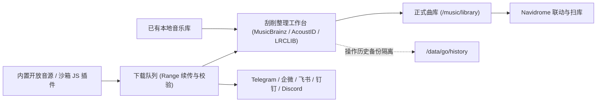

<div align="center">


# MeloKeep

**面向 NAS 与自托管场景的合规音乐库工作台与开放音源插件平台**

集 **双栏本地曲库 · 多源标签刮削整理 · Navidrome 联动 · 开放音源与纯 Go JS 插件平台 · AI 助手与 5 大机器人** 于一体


[核心能力](#-核心能力) · [内置开放音源与插件平台](#-内置开放音源与-js-插件平台) · [Docker 部署与一键更新](#-docker-快速部署) · [移动端安装与更新](#-原生移动端安装与更新) · [合规声明与版权政策](#-合规声明与版权政策-compliance--dmca-policy)

</div>

---

## ✨ 核心能力

MeloKeep 采用 **Go 单二进制核心服务**架构（内置纯 Go SQLite WAL、`goja` JS 插件沙箱与并发任务调度，仅通过轻量受控 helper 调用 `mutagen` 读写音频标签），兼顾低资源占用与 NAS 存储安全。

| 模块 | 核心能力 |
| --- | --- |
| 🗂️ **双栏本地曲库** | 类文件管理器「左目录树 + 面包屑 + 右表格」联动浏览；支持关键词筛选、游标分页、60 秒后台增量扫盘、手动真实扫盘刷新与残留空目录清理，多选悬浮操作栏支持播放、加入歌单或送去刮削整理。 |
| ✨ **标签刮削与归档** | 集成 **MusicBrainz + Cover Art Archive + iTunes + AcoustID（Chromaprint 指纹）+ LRCLIB**；支持可配置默认自动匹配阈值（50–100 分，默认 85）、折叠式资料来源（内置源/插件源）与一键勾选推荐组合（iTunes + MusicBrainz + LRCLIB）；17 项文字标签锁定防覆盖、模板批量重命名、批量失败项对齐修订版本与异步重试、`/data/go/history` 备份隔离及可逆回滚。 |
| 💿 **Navidrome 联动** | 支持 OpenSubsonic 协议浏览远程歌曲/专辑/歌手（卡片与列表双视图）、单曲下载与多选/整张专辑流式 ZIP 打包下载、同步编辑 Navidrome 歌单；App 端可独立直连 Navidrome 播放、离线与扫库（无需 Web 端重复配置）。 |
| 🌐 **开放音源与 JS 插件** | 内置 **7 个开放许可/官方试听源**，并提供 **纯 Go 沙箱 JS 插件扩展**（`MeloKeep Provider Plugin API v1`），支持在界面在线测试、安装与配置自定义插件。 |
| 🤖 **AI 助手与 5 大机器人** | 接入 OpenAI 兼容接口（Chat Completions / Responses、截图识别导入歌单、工具调用）；支持 **Telegram**（含内置 Local Bot API 2 GB 大文件）、**企业微信**、**飞书 / Lark**、**钉钉** 与 **Discord** 通知和对话。 |
| 📱 **Web 与原生移动端** | React 19 + TypeScript 响应式前端（内置 4 套外观预设与歌词字号/颜色/对齐/偏移自定义），配套 Kotlin Multiplatform + Jetpack Compose 原生 Android / iOS 客户端，全端支持版本检查与更新闭环。 |



---

## 🌐 内置开放音源与 JS 插件平台

### 1. 内置 7 个开放许可与官方试听源

MeloKeep 开箱内置以下 7 个公开合规来源，覆盖 Creative Commons 开放曲库、开源游戏音效与官方公开试听/目录接口：

| 音源 ID | 名称 | 类型说明 | 能力边界 |
| --- | --- | --- | --- |
| `AudiusMusicClient` | **Audius** | 去中心化开放音乐平台公开流 | 搜索、在线播放、下载 |
| `FMAMusicClient` | **FMA** | Free Music Archive 开放许可曲库 | 搜索、在线播放、下载 |
| `CCMixterMusicClient` | **CCMixter** | Creative Commons 混音与共享社区 | 搜索、在线播放、下载 |
| `OpenGameArtMusicClient` | **OpenGameArt** | 开源游戏音频与 CC 素材站 | 搜索、页面音频附件解析 |
| `WikimediaCommonsMusicClient` | **Wikimedia Commons** | 维基共享公共领域 / CC 音频库 | 搜索、原文件解析与下载 |
| `JamendoMusicClient` | **Jamendo** | Creative Commons 独立音乐平台 | 搜索、歌单与下载（需用户在设置填写免费申请的 `client_id`） |
| `ITunesMusicClient` | **iTunes** | 官方公开目录与播客/曲目试听 | 公开检索；音频试听显式标记为 `PreviewOnly`（30 秒官方预览） |

### 2. 纯 Go 沙箱 JS 插件扩展（Provider Plugin API v1）

除内置开放音源外，你可以通过安装单文件 JavaScript 插件扩展搜索、解析、歌单、分集、歌词与刮削元数据来源：

- **强隔离沙箱**：基于纯 Go `goja` 运行时执行，**零宿主文件系统访问、零环境变量读取、零子进程调用**。
- **内置中立工具箱 `ctx`**：提供受控 `ctx.http.request` / `ctx.http.batch`（带公网 SSRF 防护与域名白名单）、`ctx.crypto`、`ctx.encoding`、`ctx.html`、`ctx.settings`、`ctx.cookie`、`ctx.emit`、`ctx.log`。
- **资源硬约束**：插件源码 `<= 512 KiB`，单次方法调用 `15 秒` 硬超时中断，单批最多 `8` 个并发 HTTP 请求且单次调用累计最多 `24` 个 HTTP 请求。
- 详细接口规范与参考示例：
  - [MeloKeep Provider Plugin API v1 开发规范](docs/provider-plugin-spec.md)
  - [离线演示插件示例](docs/examples/mock-provider.js)
  - [公开 Podcast RSS/Atom 解析示例](docs/examples/open-podcast-rss-provider.js)

---

## 🚀 Docker 快速部署

镜像地址：`ghcr.io/agonie0v0/melokeep:latest`（同时提供 `linux/amd64` 与 `linux/arm64`，已内置 FFmpeg、`fpcalc` 及 `telegram-bot-api`）。

### 1. 准备 `docker-compose.yml`

仓库内已附带 [docker-compose.yml](docker-compose.yml) 与 [同时部署 Navidrome 的示例](docker-compose.navidrome.yml)：

```yaml
services:
  melokeep-webui:
    container_name: melokeep
    image: ghcr.io/agonie0v0/melokeep:latest
    restart: unless-stopped
    init: true
    ports:
      - "8765:8765"
    volumes:
      - ./music:/music
      - ./data:/data
      # - /var/run/docker.sock:/var/run/docker.sock # 可选：取消注释以启用 Web 端单容器一键更新
    environment:
      MELOKEEP_USER: admin
      MELOKEEP_PASS: "请改成你自己的强密码" # 若密码含 $ 请写成 $$
      # NAS 有专用目录读写用户时，填入对应 UID/GID（在终端执行 id 用户名 查看）：
      # PUID: '1000'
      # PGID: '1000'
```

### 2. 启动、更新与自动重启

```sh
# 首次启动（访问 http://服务器IP:8765）
mkdir -p music data && docker compose up -d

# 未启用 Web 单容器一键更新时，手动拉取最新官方镜像并重启
docker compose pull && docker compose up -d

# 本地源码修改后重新构建镜像并自动重启（含 Navidrome 联动示例）
docker compose -f docker-compose.navidrome.yml up -d --build

# 查看实时日志
docker compose logs -f --tail 100
```

- **Web 单容器一键更新**：如需直接在网页一键升级且不想额外部署 Watchtower 等独立容器，只需取消上方 `docker-compose.yml` 中 `/var/run/docker.sock:/var/run/docker.sock` 的注释后重建一次容器。之后在 Web「设置 → 版本与更新」即可一键拉取最新镜像，内置 `self-update-helper` 会自动平滑替换容器并具备失败回滚保护，待容器重启就绪后网页自动刷新；未挂载 `docker.sock` 时仍可通过 `docker compose pull && docker compose up -d` 或外部更新 Webhook 完成升级（详见 [进阶配置手册](docs/configuration.md#web-单容器一键更新)）。

| 宿主机目录 | 容器路径 | 存储内容 |
| --- | --- | --- |
| `./music` | `/music` | 下载音频、整理入库目录（默认 `/music/library`）及歌词封面 |
| `./data` | `/data` | `data/go/` 数据库、应用配置、已安装插件、歌单收藏与任务历史备份 |

---

## 📱 原生移动端安装与更新

前往 [GitHub Releases](https://github.com/Agonie0v0/melokeep/releases/latest) 获取最新双端安装包（版本发布时自动随镜像同步构建）：

- **Android**：下载 `MeloKeep-<version>-android.apk` 直接安装（正式签名版支持无缝覆盖升级）。
- **iOS**：下载 `MeloKeep-<version>-ios-unsigned.ipa`，通过 SideStore / AltStore / TrollStore 自签安装。

移动端采用纯原生 **Kotlin Multiplatform + Jetpack Compose** 架构（无 WebView 套壳），主要特性包括：

- **双源曲库与高频交互**：统一管理 Navidrome 与本地库，所有列表页均支持下拉刷新；歌曲行支持左滑下一首播放、右滑加入队尾（多选态自动禁用）；保留轻量离线下载能力并在副标题展示极简已离线微标。
- **独立服务直连与工坊扫库**：工坊内触发扫库优先直连 App 自身配置的 Navidrome，无需在 Web 端重复填写配置；底部采用 4 Tab 布局（`曲库` / `探索` / `工坊` / `我的`），「我的」合并为 5 大分组工作台，服务列表优先显示自定义名称并默认隐藏敏感地址。
- **应用内更新闭环**：Android 支持应用内检查新版本、直接下载 APK 并拉起系统安装；iOS 支持查看 Release 更新日志并一键拉起 SideStore / AltStore 或跳转到安装包下载。

更多编译、联调与签名详情见 [移动端开发与构建指南](docs/mobile-app.md)。

---

## 🛠️ 源码构建与开发自动重载

依赖要求：**Go 1.27+**、**Node.js 24+**，以及运行时工具 **Python 3.11+**（`mutagen`、`requests[socks]`、`python-dotenv`）、**FFmpeg / ffprobe**、**fpcalc**。

### Windows 本地热重载开发（自动重编译并重启后端）

```powershell
# 启动 Go 后端监听（修改 go/ 下 .go / .sql / go.mod 后自动停机、重编译并重启）+ Vite HMR 前端
.\dev.ps1

# 仅启动后端监听（用于移动端联调或单独接口调试）
.\dev.ps1 -ListenHost 0.0.0.0 -BackendOnly
```

### 手动编译与测试验证

```sh
git clone https://github.com/Agonie0v0/melokeep.git && cd melokeep

# 构建前端并编译 Go 单二进制主程序
npm ci --prefix frontend && npm run build --prefix frontend
cd go && CGO_ENABLED=0 go build -o ../melokeep ./cmd/melokeep && cd ..

# 启动服务（以单实例运行，避免重复消费机器人与队列）
./melokeep --host 127.0.0.1 --port 8765 --static-dir frontend/dist
```

开发测试：

```sh
npm run format:check --prefix frontend
npm test --prefix frontend
npm run build --prefix frontend
cd go && CGO_ENABLED=0 go test ./...
```

---

## ⚖️ 合规声明与版权政策 (Compliance & DMCA Policy)

1. **软件定位与内置来源**：MeloKeep 是一款面向个人自托管与 NAS 场景的本地曲库管理、元数据整理及开放音频插件工作台。项目默认仅内置开放许可（Creative Commons / 公共领域）或官方公开试听/目录接口。
2. **中立插件机制**：MeloKeep 的 JavaScript 插件系统为中立、通用的标准化扩展运行时。项目官方仓库**不提供、不内置、不托管、亦不背书**任何未经授权的第三方商业音源、破解逻辑或侵权内容来源。
3. **用户责任**：用户自行安装、编写或配置的任何第三方插件及其 API 凭据、代理设置与访问行为，均由用户自行评估合法性并承担全部责任，使用前请确保遵守所在地法律法规及目标站点的服务条款。
4. **版权与 DMCA 反馈渠道**：我们高度尊重知识产权。若您作为权利人或授权代表认为本仓库中的任何文档、示例代码或默认集成接口侵犯了您的合法权益，请通过本仓库的 [GitHub Issues](https://github.com/Agonie0v0/melokeep/issues) 或 GitHub Security Advisories 提交权属证明、具体路径与处理请求；项目维护者将在核实后尽快下架、修正或移除相关内容。

---

## 📚 专题文档与开源许可

| 文档 | 内容范围 |
| --- | --- |
| [Provider 插件开发规范](docs/provider-plugin-spec.md) | `MeloKeep Provider Plugin API v1` 规范、`ctx` 工具箱与沙箱限制 |
| [完整配置与排障手册](docs/configuration.md) | 环境变量、NAS 权限、机器人回调地址与故障排查 |
| [AI 助手与聊天渠道](docs/ai-assistant.md) | OpenAI 兼容配置、截图识图歌单与 5 大机器人接入指南 |
| [音乐库与刮削整理](docs/music-library.md) | MusicBrainz / AcoustID / LRCLIB 刮削、模板语法、监控与 Navidrome 联动 |
| [移动端开发与构建](docs/mobile-app.md) | KMP + Jetpack Compose / iOS 原生客户端构建与联调指南 |
| [Go 模块架构设计](docs/go-architecture/README.md) | 模块职责边界、数据事务与故障恢复设计参考 |

- 开源协议：[MIT License](LICENSE)
- 第三方组件与许可声明：[NOTICE.md](NOTICE.md)
