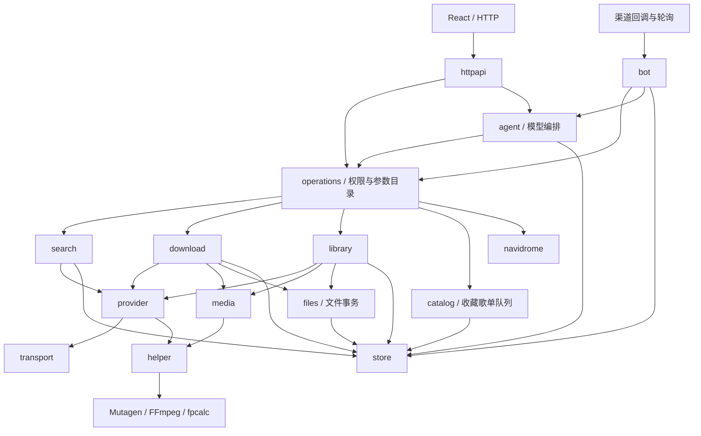
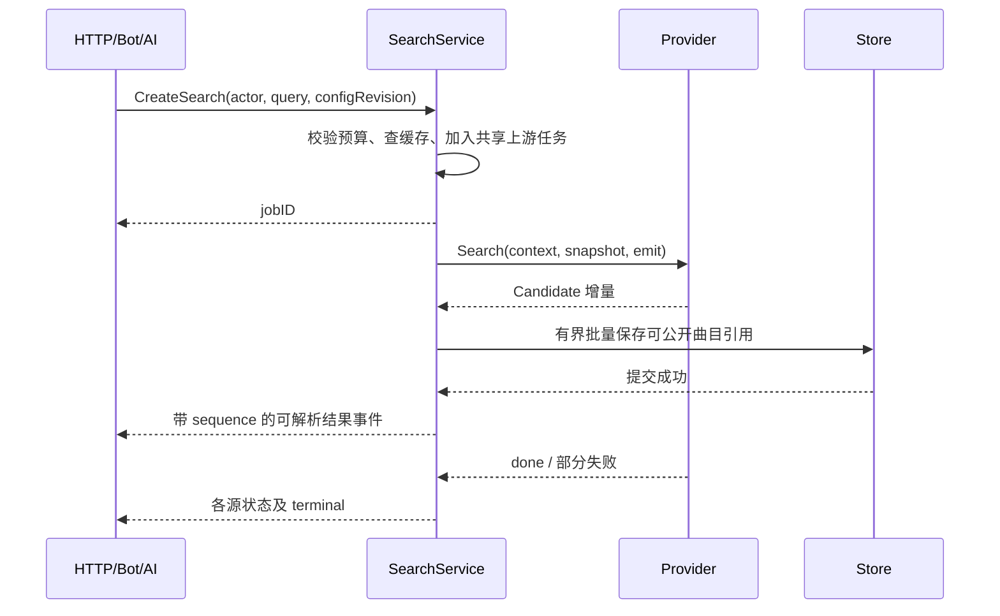
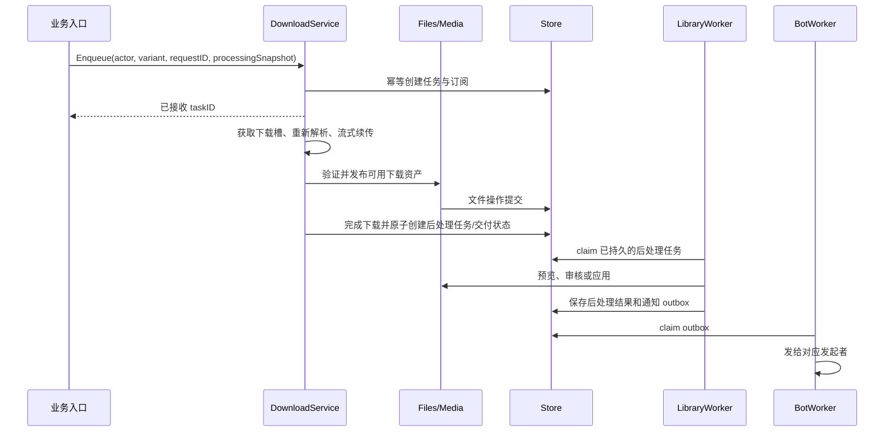

# 目标架构：有明确边界的 Go 单体

设计基线 v1。先读 [入口](README.md)。存储和 wire 细节分别见专门文档。

## 1. 产品与部署假设

- 面向个人/家庭、可信管理员和获授权的机器人用户，共享音乐库；不是多租户 SaaS。
- 一套音乐根目录只有一个正式服务写入者。多用户请求可并发，但不支持多实例集群写入。
- Linux amd64/arm64 容器与 Windows 原生是必要目标。数据库位于支持 SQLite WAL 的本地文件系统；音乐可位于 NAS 挂载，能力不足时安全拒绝写入。
- 保留已实现能力，不把现有 partial 音源升级为承诺支持完整会员音频。
- 保留旧 UI 和公开接口；只有新曲库分页入口及必要适配需要前端改动。
- 性能目标是相同工作量下资源更少、响应更稳。不得通过减少音源/结果/标签/保护功能达标。

非目标：微服务、Redis、通用工作流引擎、任意动态插件、全事件溯源、全平台音源修复、浏览器/WASM 重写、自研音视频编解码。

## 2. 固定架构决定

| 决定 | 原因 | 明确代价 |
| --- | --- | --- |
| 一个 Go 服务 + 按需工具进程 | 便于部署，有界资源和统一生命周期 | Go 进程内错误需隔离和恢复；单实例容量上限 |
| 保留 React | UI 已完整，无服务端 Node 常驻开销 | 前端大列表仍要分页改造 |
| 独立 Go SQLite + 一次导入 | 避免两个状态模型竞争，保留旧数据 | 生产回退需要协调升级后的文件变化 |
| 业务领域各有 Service，store 为具体 SQL 实现 | 所有入口遵守同一规则 | 需要显式跨域短事务方法 |
| 持久工作按域分队列 | 下载、文件处理和通知失败语义不同 | 少量重复的 worker loop 比通用引擎更易维护 |
| 原生源实现 Go；Mutagen 作为受控标签 helper | 消除常驻 Python 服务，同时保留多格式成熟写标签能力 | 运行镜像保留轻量 Mutagen helper 依赖 |
| 文件操作有持久日志 | DB 事务无法原子包含文件系统 | 多文件发布不是瞬间原子，必须有恢复过程 |
| API DTO 与内部模型隔离 | 保留旧 ID/字段，不让旧格式主导内部模型 | 维护一层明确映射 |
| Operation 目录显式注册 | 让 AI/HTTP 共享权限和校验 | 新管理能力必须显式登记，不自动获得 AI 权限 |

禁止在本次迁移中添加“未来可能需要”的抽象；接口仅用于确有多个实现的 provider、helper 或真实测试隔离边界。

## 3. 组件与调用方向



箭头是调用/依赖方向，不意味着所有访问都经过 Operation。HTTP 媒体流、SSE、鉴权和 AI 会话接口直达专属服务；普通 JSON 管理操作使用 Operation 目录。

最底层 `model`、`config`、`auth` 中的纯类型/校验不依赖业务服务。`cmd/melokeep` 是唯一组装入口，持有启动/关闭顺序，不能成为业务工具包。

### 3.1 包与文件所有权

第一阶段 Go 代码放在 `go/` 子目录，独立 go.mod；避免在旧根目录产生半迁移的入口。最终发布可保留此布局。

| 包 | 拥有什么 | 禁止做什么 |
| --- | --- | --- |
| cmd/melokeep | 组装依赖、启动、信号、维护子命令 | 不含音源/整理业务 |
| internal/model | 不可变身份、状态枚举、错误码、共享请求类型 | 不含 SQL、HTTP、全局配置 |
| internal/config | 启动配置、不可变配置快照、revision | 不在运行时自动升级真实数据 |
| internal/auth | Actor、能力检查、会话、CSRF、凭据引用 | 不信任客户端自报角色 |
| internal/operations | 管理操作目录、schema、验证、dispatch | 不反射暴露全部路由；不做网络回环 HTTP |
| internal/httpapi | 旧 DTO、路由、SSE、Range、静态资源 | 不直接修改 DB/文件；不复制业务规则 |
| internal/catalog | 曲目引用、收藏、播放队列、本地歌单 | 不按歌名自动合并跨源身份 |
| internal/search | 共享搜索、缓存、resolve 合并、订阅 | 不拥有下载任务生命周期 |
| internal/provider | 每源 Search/Resolve/Playlist，能力表 | 不直接写 DB、正式曲库；不绕过 transport |
| internal/transport | 公网与特定信任域 HTTP 策略 | 不读取任意全局代理/环境来改变行为 |
| internal/download | 创建/控制下载、传输、完成交接 | 不 import library/bot/agent，不修改标签规则 |
| internal/library | 索引、刮削预览、字段锁、整理/恢复调度 | 不自行绕过 files 发布或删除文件 |
| internal/files | 根目录约束、资产使用锁、文件日志与发布恢复 | 不调用模型/机器人；不持有网络请求 |
| internal/media | 标签、解码、转码、指纹、CUE 的类型化操作 | 不接收任意 shell 命令/FFmpeg 自由参数 |
| internal/helper | 受控启动、NDJSON、环境、超时、进程树 | 不给 helper 主数据库访问或正式发布权 |
| internal/navidrome | Subsonic HTTP、能力与本地映射 | 不能把任意远端路径当本地可删除路径 |
| internal/bot | 渠道接入、用户归属、收件去重、通知交付 | 不修改下载/整理内部状态 |
| internal/agent | 模型协议、会话、工具调用、安全恢复 | 不调用任意 URL/命令、不绕过 operations |
| internal/store | SQL、迁移、事务性状态变更 | 不 import 上述业务服务、不做网络/文件 I/O |

`download` 完成时，通过 store 的命名事务完成“结果记录 + 已配置后处理任务创建”；library worker 消费自己的持久任务。交付记录也在对应状态变更事务中产生，bot 消费 outbox。只用针对这些真实场景的表和方法，不引入通用事件总线。

### 3.2 跨领域协作的唯一规则

1. 单域操作由该 Service 发起 store 事务。
2. 跨域原子变化由 store 提供具体方法，例如 `CompleteDownloadAndScheduleProcessing`；输入是 model 类型，不传业务 callback。
3. DB 事务内部不能进行网络、helper、完整哈希、文件复制或等待媒体读者。
4. 服务不拿全局锁调用其他服务；锁顺序固定为“资源槽 → 资产使用锁 → 短 DB 事务”。SQLite 事务外才通知内存唤醒器。
5. 唤醒器仅优化延迟；丢失唤醒不会丢任务。各 worker 启动时及低频巡检从 DB 取 due 工作。

## 4. 领域模型与身份

| 概念 | 身份与用途 |
| --- | --- |
| ProviderTrack | provider_id + 平台稳定 ID；可带平台支持的子集/分集身份，不使用标题作主键 |
| MediaVariant | 同一平台曲目的版本、编码/音质选择；持久 key 不包含临时签名 URL |
| Asset | 本地文件稳定 ID；改名、移动、标签修改后 ID 不变 |
| PublicTrackRef | 旧 API 可见 track ID；通过 alias 映射，不要求其等于内部 ProviderTrack |
| ResolvedMedia | 短期音频位置、有效期、必要请求凭据引用；私有缓存，不直接持久进公开 DTO |
| Download | 某一次下载意图与所选版本；可以关联共享传输结果，但用户归属不转移 |
| LibraryJob/Item | 一批处理请求及单文件预览/应用结果；保留创建时配置快照 |
| FileOperation | 可恢复的一次文件发布/编辑/移动/删除/还原操作 |
| Actor | web 管理员或渠道用户及本轮有效权限；由可信入口构建 |

新内部 ID 使用随机 UUID 字符串（具体无连字符/带连字符在 T02 固定）；旧 ID 原样作为 alias。SHA 哈希用于内容/配置指纹和去重，不把它当人类歌曲身份。

同歌名不同 Live/Remix/专辑不得自动归并。音质变化返回明确 conflict，不能静默从无损降级。大小未知不等于零；统一时间单位，duration 用毫秒内部整数，旧 API 秒数在边界转换；时间戳持久化为 UTC 毫秒，旧秒级字段映射后返回。

Provider 的请求对象不可变，不能像旧实现把当前请求 overrides 写到共享 provider 实例。配置 revision、账号/凭据 revision、代理策略快照进入任务和缓存 key；敏感值不进入日志、模型消息或缓存 key 明文。

## 5. 关键内部接口约束

以下签名是 T02 生成编译契约的输入；类型细节只允许由 T02 统一冻结，不允许各实现代理独立定义同名类型。

```go
type Provider interface {
    Capabilities() Capabilities
    Search(ctx context.Context, req SearchRequest, emit func(Candidate) error) error
    Resolve(ctx context.Context, req ResolveRequest) ([]ResolvedMedia, error)
}
type PlaylistProvider interface {
    Playlist(ctx context.Context, req PlaylistRequest, emit func(Candidate) error) error
}
```

调用前已经获得并发槽；emit 必须可返回取消/容量错误，provider 不应无限缓存结果。结果页和响应体有上限；错误区分 unsupported、auth_required、rate_limited、unavailable、invalid_response、cancelled。

Service 的公开方法一律显式接收 context 与可信 Actor（真正系统工作使用 SystemActor）；长任务使用服务生命周期 context，不继承已返回的 HTTP 请求 context。客户端断开是否取消由该业务决定，不能让已确认创建的下载随 HTTP 返回而终止。

操作目录每项包含：稳定名称、method/path 映射、输入/输出 schema、读写类别、所需能力、执行入口、是否支持 request id、敏感字段标记、是否允许 AI 调用。目录只保存稳定描述和注册接口；各领域 handler 在 cmd/melokeep 装配层或对应领域包初始化时显式注册，operations 包不反向依赖 search、download、library、navidrome。HTTP、机器人、AI 都必须经过同一业务验证；HTTP 解码校验不能是唯一校验。

内部错误包含 code、可展示 message、retryable、retry_after 和私有 cause。旧 HTTP 保留状态码与 detail；新字段只能兼容新增。可重试意味着策略允许重试，不意味着写请求可盲重放。

## 6. 搜索、播放与下载时序

### 6.1 搜索



先保证事件中的曲目可被 Resolve 读取，再发布该结果。持久化可按最多 50 条或 50 ms 批量，具体由基准校准；禁止在事件中返回尚不可寻址的 ID。

缓存 key 包含规范化 query、provider、配置/凭据 revision、结果数、lazy 模式；失败和空结果不写成功缓存。相同请求共享上游，用户自己的搜索 job 与订阅独立。一个用户退出仅解除其引用，最后引用消失后才按宽限期取消上游。

搜索状态：`queued → running → complete | partial | failed | cancelled`。queued 超预算失败；各源结果独立。搜索运行状态不在重启后继续，旧 job 返回兼容“搜索过期”，已保存 track 引用仍可用。

每 job 的事件日志有界但不静默丢事件：达到硬上限就结束搜索并记录容量原因，已保留事件可重放；保留窗口结束返回过期。慢消费者断开并用 Last-Event-ID 重连，不阻塞其他订阅。

### 6.2 播放

先找有效本地 Asset；没有则按选择的 Variant 获取一组 ResolvedMedia，合并并发解析；再用受控 HTTP 代理流。解析 URL 只短期缓存，不因地址过期改变曲目身份。

本地文件播放取得资产读使用权。编辑/移动/删除需要写使用权：停止接收该资产的新读者后最多等候 5 秒，仍有读者则返回 busy 或把后台操作延后；不偷偷打断播放，不在持有 DB 事务时等待。Windows/Linux 采用一致语义，不能利用 Unix 可删除打开文件的特性掩盖 Windows 冲突。

Range/206/416、If-Range、HEAD、Content-Type、Content-Length、客户端断开关闭上游/文件句柄必须有契约测试。媒体 body 流式复制，不使用全量 ReadAll；允许无总长响应。

### 6.3 下载与后处理



如果 files 提交后、download 完成事务前崩溃，恢复根据 operation 与 download 的关联核对资产并补齐任务状态；不再次下载。文件提交与任务完成两个事务间的间隙必须可推导恢复。

下载传输成功与后处理成功分开记录。后处理需要人工确认时仍可取回已下载文件；重试整理不重新下载。多入口复用同一下载不会夺走原发起者管理权，新入口建立独立订阅/访问关联。

## 7. 持久任务状态机

### 7.1 下载

| 当前状态 | 事件 | 后继与动作 |
| --- | --- | --- |
| queued | worker claim | resolving；revision 增加，记录 attempt |
| resolving | 获取匹配版本 | downloading |
| downloading | 原始内容完整 | verifying；核对长度/容器/需要的验证 |
| verifying | 验证成功 | publishing；建立文件操作日志 |
| publishing | 资产已提交 | complete；创建后处理或交付记录 |
| queued/resolving/downloading/verifying | pause | pause_requested；停止实际工作、保存检查点后 paused |
| 非终态且尚无已提交资产 | cancel | cancel_requested；到安全点后 cancelled，清理临时文件 |
| publishing | pause/cancel | 先完成或回滚文件事务，再返回实际结果；不撤销已提交资产 |
| 可恢复网络错误 | budget 未耗尽 | retry_wait，持久 next_attempt_at，指数退避和抖动 |
| 任意阶段失败 | 不可重试/预算耗尽 | failed 或 needs_attention（文件状态需核对） |
| paused/failed/retry_wait | 显式 resume/retry | 校验身份、版本和检查点后 queued |
| cancelled | 显式 retry | 清除旧传输检查点后 queued |
| complete | 重复请求/控制 | 返回结果或兼容冲突；不再次发布 |

内部状态多于旧 DTO 时，通过明确投影映射成旧 UI 可识别的值，detail/processing 显示具体阶段。请求取消不是已经取消：在 worker 确认前 API 不声称临时文件已清理。

每 attempt 取得 revision/epoch，更新时 CAS；旧 worker 的迟到回调不能覆盖新任务。重启不把旧 running 直接改 queued：先恢复关联文件事务，再把传输阶段转 paused，符合旧版安全恢复行为；用户或获授权 AI 再继续。

### 7.2 曲库处理

Job 是 Item 状态汇总，不作为每个文件都已成功的证明。

`queued → scanning → preview_ready | needs_review → applying → complete | partial | failed`，另有 `paused/cancelled/needs_attention`。

每 Item 保留输入文件 revision、候选、来源证据、字段锁、配置快照和目标路径。应用前重验全部相关文件/附属文件；冲突时拒绝覆盖。取消停止后续 Item，当前文件先提交或回滚。重试仅选择未完成项；恢复历史形成新的受审计操作，不删除历史链。

### 7.3 AI

`idle → running → waiting_tasks → running → complete`；可转 `stopping → interrupted`、`failed`、`needs_decision`。

工具调用先持久记录 command ID 与意图，内部幂等写入可凭结果回查；外部无法判定的写入进入 unknown，不自动重放。模型流中断不重复执行已完成工具。等待任务通过数据库状态和唤醒完成，不靠持续请求模型。

Actor 权限在创建本轮时保存，但每次写操作再受当前全局/渠道开关约束；撤权立即阻止新的写操作。停止 AI 不取消已创建的独立下载/整理任务，除非用户明确发起对应业务取消。

### 7.4 通知和收件

收件先验签/校验时间窗与用户，再以 channel+平台消息 ID 唯一去重持久化；成功持久化后才 ACK。平台要求快速确认时只做轻量验证和入队。

通知：`pending → sending → sent | retry_wait | failed | delivery_unknown`。外部成功但本地尚未记账时崩溃，不能知道是否已送达；提供方支持幂等键则用固定键重试，否则默认 delivery_unknown，不自动重复发送，允许用户显式重发。这是外部一致性的限制，不宣称 exactly-once。

## 8. 幂等与权限

- HTTP 重试幂等 key 是 actor+operation+client_request_id，保存规范化 payload hash；同 key 不同 payload 返回 409。`force_new=true` 时必须同时提供非空 `intent_nonce`；缺少 nonce 返回 400。普通重试使用默认 intent scope，显式重新下载使用新的 scope。
- 操作参数规范化不随意改变源 ID、大小写敏感标识和模板字符串。
- 业务“是否已下载”与请求幂等分开。默认提示/复用匹配版本；用户显式重新下载允许创建新意图。不能用标题作去重键。
- 当前同一输出资产的冲突由 files 层串行化；数据库唯一约束防止并发登记同一活动工作，具体键见存储文档。
- Web 管理员、渠道允许用户、只读 AI、系统 worker 使用明确 Actor；不可由模型提供 role、路径授权或 owner。
- 秘密保存在私有配置/数据库字段，权限限制和日志脱敏沿用并加强；不承诺没有密钥管理基础设施时实现有意义的透明加密。
- 搜索任务和短缓存可过期；收藏/歌单/历史引用的身份不能随着缓存淘汰丢失。

## 9. 并发、内存和背压

初始预算是保守默认，T01/T23 校准；均为整个服务共享上限，不按请求重新创建一份。

| 资源 | 默认 / 上限行为 |
| --- | --- |
| 活动搜索 job | 6；超限明确拒绝，不无限排队 |
| provider 搜索槽 | 4，可配置；每域 HTTP 请求限制独立，避免分页乘法扩张 |
| 下载传输槽 | 2，配置最大 4；持久队列最多 1000 未完成意图，满时拒绝新任务 |
| 音频重工具 | FFmpeg/fpcalc 合计 1；每下载不自行绕过限制 |
| 库文件写入 | 1；每资产读写使用锁保护播放/编辑 |
| 提取 helper | 2；标签 helper 1；全进程 helper 合计初始 3 |
| AI | 每会话 1、全局 2；渠道命令入口不等待模型完成 |
| 通知 | 全局 2、各渠道速率限制；持久 due 队列，不能内存无限积累 |
| 搜索成功缓存 | 8 MiB、30 秒、最多 32 项，按有效编码字节计并监测实际 heap |
| 解析缓存 | 16 MiB，过期时间取源到期减安全窗口及本地上限的较小值 |
| 单 search job 事件 | 最多 4096 条且 4 MiB；最多保留 32 个已结束 job、TTL 5 分钟 |
| helper 元数据响应 | 16 MiB；图片/封面和音频有独立大小策略，不混用限制 |
| 普通 JSON 请求 | 默认 1 MiB；图片入口显式更高并限制解码后大小，沿用旧 5 MiB 图片能力 |
| 单个整理任务 | 最多 1000 文件；预览持久分页，不加载整库 |

媒体 body 使用可复用小缓冲且有全局并发限制；HLS 初期顺序下载或最多 2 段有界预取，禁止把整张播放列表音频留在内存。日志为有界环形及轮转文件，禁止记录完整二进制/凭据/模型图片。

预算耗尽产生明确错误或延迟执行，不无声截断音乐/歌曲/通知。停止服务设总 deadline，所有阻塞网络设置连接/响应超时；HTTP stream 使用 idle timeout 而非短总时长限制整首音频。

## 10. 安全网络和进程边界

三类 HTTP 信任域分开：公网 provider/media；管理员显式配置的 Navidrome/模型/机器人端点；固定本机工具端点。用户曲目 URL 不得进入允许私网的客户端。

公网 Dial 时解析并校验所有候选 IP，拒绝私网/保留/多播等目标；连接固定到已验证 IP，TLS SNI/Host 保持原域名。每次重定向复验，跨 origin 清理敏感头，禁止跨站重放带敏感 body 的提交。

连接池按 origin、proxy、TLS-policy、配置 revision 分区；CookieJar 按账号隔离。配置改变后旧连接池排空/销毁，不把新 Cookie 注入其他账号正在执行的请求。旧任务凭据撤销后停止下一网络步骤，不能无限保留旧授权。

代理 CONNECT/SOCKS 也必须绑定校验后的目标；若代理模式必须让远端 DNS 解析而无法验证目标，则明确不支持该安全模式，不能悄悄绕过校验。以测试证明 HTTPS SNI 和代理身份不被破坏。

helper 只允许固定可执行文件与结构化参数。凭据经 stdin/private 文件传递，不放命令行或日志。Linux 使用独立进程组；Windows 使用 Job Object 并禁止 breakaway，启动窗口隐藏。CommandContext 本身不足以清理子孙进程。

软件接口限制不是操作系统沙箱。helper 属于受信任随包代码；若依赖任意第三方插件或其可访问真实音乐目录，应增加 OS 隔离后才放开。v1 禁止加载用户 Python 插件。

## 11. 索引与配置行为

每个音乐根拥有 scan generation。扫描成功遍历完整范围后才能将该 generation 未见项标为 missing；根离线、权限错误、取消/中断不得把旧索引标为删除。删除与 missing 区分，恢复根后重扫可恢复状态。

元数据用 size+mtime_ns 发现变化，不能证明内容未改；用于覆盖/恢复决策的文件指纹需要更强校验。内部写入主动更新索引，周期扫描负责外部变化；watcher 事件只是提示。

分页稳定排序为 sort_key+asset_id，cursor 带过滤条件 hash 与 index_revision。过滤或排序参数与 cursor 不匹配返回 400；index_revision 过期返回 409 并要求前端重置 cursor。v1 提供一致的“当前索引视图”分页，不承诺长时间翻页跨修改的全库快照；前端刷新时重置 cursor。

配置保存校验后产生新 revision，任务持有对应规则快照。代理/账号等敏感配置变化清缓存并重建客户端；文件命名规则变化只作用于新任务，旧预览必须明确重新生成。

## 12. 启动、退出与恢复顺序

启动：校验配置/根目录 → 获取 Go 单实例 OS 锁 → 验证独占部署写权 → 打开本地 DB/检查版本 → 检查 helper 能力 → 恢复未完成文件操作 → 核对下载/整理/AI/通知中断状态 → 启动队列/索引 → HTTP ready。

旧 Python 版本不会遵守新锁；Go OS 锁无法防止旧服务同时启动。生产写权切换必须停旧容器/服务并禁用其自动重启，不能把一个新 lock 文件当跨版本互斥证明。

恢复期间 liveness 可用，readiness 为 false，不接收写操作。发现文件冲突只冻结相关资产/任务并报告，是否允许无关服务 ready 由恢复结果确定；数据库不完整则全局不 ready。

退出：停止接新任务/回调 → 持久暂停意图 → 取消搜索和模型请求 → 给文件操作到安全点的时间 → 关闭网络流 → 终止 helper 进程树 → flush 状态/日志 → 关闭 DB/释放锁。到达 deadline 可强制结束，但下一次启动必须按日志恢复；不在超时后假记 complete。

readiness 不依赖所有外部音源在线；健康检查不向音源/模型发请求。诊断输出包含配置 revision 和各组件状态，秘密脱敏。pprof 只允许管理员受限入口或默认关闭。

## 13. 迁移与交付策略

在代码层按模块实现，在运行层以隔离 Go 候选版测试；不在生产里建立越来越复杂的双服务反向代理。

旧 DB 和配置从一致性快照导入独立 Go DB，原有身份/路径保留 alias。全功能候选完成前旧版仍是正式写入者；Go 只用复制或生成的数据测试。切换时一次接管端口和音乐根写权。

默认发布容器镜像包含受控 Mutagen helper、FFmpeg 与 fpcalc 运行环境，默认不常驻 Python 服务。内置开放音源与沙箱 JS 插件搜索/下载全部使用 Go 原生执行，写标签按需短暂运行 Mutagen，发行说明须如实注明。

TagLib 替代是独立后续决定，需七种格式与恢复验证通过后才能改变默认。没有必要为了“语言纯度”阻塞核心服务收益。

## 14. 风险验证和设计变更

T01 验证失败时的固定处理：SQLite pure-Go 驱动不满足预算→保持 database/sql 边界，对照 CGO 驱动，负责人提交 ADR；目标 FS 缺少安全发布能力→该根只读/拒绝修改；TLS 兼容不足→有限受控 helper，不全局跳过 TLS；Mutagen helper 不能忠实回归→禁止开启写标签发布，而不是用 FFmpeg 盲替。

任何改变模型身份、state enum、表结构、provider/helper 协议、权限语义的需求必须先修改契约，标注影响任务并重新跑对应门禁。函数内部和单源解析实现由执行代理自主决定，不需每一行都走设计审批。
