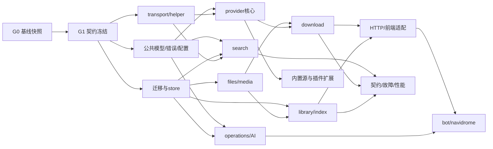

# 子代理执行手册

本手册把目标架构拆成可以独立验收的任务。每个子代理只拥有自己的目录和 fixture；公共类型、数据库 schema、provider 注册表、API 清单由核心契约代理维护，集成负责人串行合入。代理没有权限自行决定未写入本文的架构行为。

## 1. 总规则

1. 所有代理开始前读取 `README.md`、`architecture.md`、`storage-and-recovery.md`、`compatibility-contracts.md` 以及本任务书。
2. 开始实现前必须通过 G0 静态检查和 G1 契约冻结。G1 以前只允许采集、fixture、风险样机，不创建会被其他代理依赖的公共 Go 类型。
3. 每个任务声明 owner、输入契约版本、修改目录、输出、测试命令、未解决风险。未列出的文件不应修改。
4. 不允许各代理自行改 `go.mod`、公共 DTO、`internal/model`、migrations、provider 注册表或前端 API 类型。变更先提交 contract change，由集成负责人一次性更新并通知消费者。
5. helper 无主数据库写权和正式曲库写权。Provider 不直接写 DB/文件；HTTP、Bot、AI 不复制业务状态机。
6. 子代理完成后不得自行宣称全局通过；由集成负责人在主工作区串行合入并运行跨包测试。代理之间共享工作区时仍按目录所有权执行，禁止同时写同一文件。
7. 失败时保留最小复现 fixture 与日志。不得删除测试、放宽路径/凭据校验、把 `needs_attention` 改成成功或用 sleep 掩盖竞争。

## 2. 依赖图与门禁



每个门禁由集成负责人执行：

- **G0 基线：** 固定旧 commit、依赖 lock、Docker/Windows 启动方式、契约采集临时配置、搜索/下载/文件/AI 样本；生成 `contracts/v1/manifest.json`。不得读取用户凭据或访问真实音乐根。
- **G1 契约冻结：** 运行态路由、OpenAPI、SSE、错误、DTO、内置音源清单、存储 schema、helper NDJSON v1 和权限样本签名。公共契约版本 `v1`；所有后续变更带影响列表。
- **G2 核心闭环：** 一源 Search→Resolve→播放/下载→Asset→恢复；SQLite/文件事务故障测试通过；静态 React 主路径使用 Go API。
- **G3 核心源：** B1 六源、旧 API、收藏/歌单、分页索引、迁移副本、跨平台 helper 通过。
- **G4 集成：** library、Navidrome、机器人、AI、剩余源分批完成，旧 UI/CLI 兼容样本全绿。
- **G5 发布：** 旧版停写切换、回滚、24 小时耐久、资源基准、Linux amd64/arm64/Windows 构建和许可证清单通过。

## 3. 任务包

### T00 基线与契约采集（3–5 人日）

**修改范围：** `contracts/v1/`、`tools/contract_snapshot.py`、`tests/contract/`；不得修改业务。

启动临时旧版，导出有效路由及优先级、OpenAPI、配置默认值、鉴权错误、六源脱敏 fixture、SSE 首条/重连/取消/过期、媒体 Range、任务状态、模板和迁移样本。运行态优先级要解释 CSV 的 131 声明/126 唯一统计。隐藏 Cookie、Token、密码、完整签名 URL；保留 null/缺失区别。

**验收：** 相同环境可重复生成；至少包含匿名、登录失败、无权限、取消、超时、损坏数据、慢客户端样本；真实网络/机器人/AI 写入全部关闭。

### T01 技术风险样机（5–8 人日）

**修改范围：** `go/risks/`、隔离 fixture、文档结果；不得创建生产包依赖。

验证纯 Go SQLite 驱动 WAL/foreign keys/busy timeout/崩溃恢复；Windows/Linux 进程组/Job Object 清理；Range/HLS；TagLib 或 Mutagen helper 七格式读写；公网 DNS/代理/SNI；100k 模拟索引扫描。用最小可运行样机记录内存、CPU、吞吐和失败证据。

**验收：** 每项给 pass/blocked、环境、替代方案。技术风险未验证不得由后续代理自行假定。

### T02 公共模型、错误、配置和 Operation schema（4–6 人日）

**修改范围：** `go/internal/model`、`go/internal/config`、`go/internal/auth`、`go/internal/operations`；公共契约只能由本 owner 改。

实现 Actor、权限、ProviderTrack、MediaVariant、ResolvedMedia（只存在运行时，Provider Resolve 返回 `[]ResolvedMedia`）、Asset、Download/Library/Outbox 状态、错误码、配置 revision、稳定 ID、DTO adapter schema。Operation 目录只定义显式注册接口和 method/path、读写 effect、能力、敏感字段、幂等策略；各领域 handler 由 cmd 装配层或领域包注册，不能让 operations 反向依赖尚未完成的领域包。

**验收：** 无 SQL/HTTP/文件依赖；golden JSON 保持旧字段；MediaVariant 永不包含 URL/cookie；Resolve 返回切片且不持久化 ResolvedMedia；同幂等 key 不同 payload 409；force_new 缺少 intent_nonce 返回 400，且与传输重试分开。

### T03 Store、迁移和恢复索引（8–12 人日）

**修改范围：** `go/internal/store`、`go/migrations`、`go/cmd/melokeep migrate`、隔离迁移 fixture。

实现独立 `data/go/melokeep.db`、schema checksum、短事务、CAS、outbox/inbox/operation_requests、下载与 library 表、scan generation、游标索引。导入旧 DB/config/.song/pickle 档案；旧源只读。提供 integrity report、dry-run、重复导入检测。

**验收：** 同一快照幂等导入；秘密不出报告；WAL 只在本地 DB；开启失败/断电 fixture 后恢复状态符合矩阵；SQLite 事务不等待网络/文件 I/O。新增 `/api/library/files` 的 cursor/filter hash/index_revision 规则与兼容文档完全一致。

### T04 Transport 与 helper supervisor（6–10 人日）

**修改范围：** `go/internal/transport`、`go/internal/helper`、`helpers/mutagen` wrapper；不修改 provider 注册表。

实现三类信任域、公网 DNS/IP/重定向/SNI/代理约束、连接池 key（origin/proxy/TLS-policy/config-revision）、账号 Cookie 隔离和配置更新排空；NDJSON v1 hello/run/progress/result/error/cancel；输出/超时/路径/凭据限制；Linux 进程组、Windows Job Object。

实现 `batch_read_tags` 只读批处理：建议每批最多 200 文件、单条结果可失败、有界输出和总超时，只在 Go 直接读取失败或风险样机证明需要时调用；扫描器不能为 100k 文件启动 100k 个 Python 进程。写标签保持单文件单操作 helper。

**验收：** 重定向 SSRF、代理远端 DNS、Cookie 串账号、子进程泄漏、超限 JSON、取消和父进程退出均有测试；helper 永不写主库/正式曲库。

### T05 Provider 核心接口与内置开放音源（6–10 人日）

**修改范围：** `go/internal/provider`、`go/internal/provider/builtin`、`go/internal/provider/catalog`；禁止修改 model/registry 公共契约，新增字段走变更。

实现 provider transport adapter、Search/Resolve/Playlist/Episodes/Lyrics/Metadata 语义、能力表、错误分类、限额、凭据快照。内置 7 个开放许可与官方试听源，不把标题合并跨源，不持久化 ResolvedMedia。

**验收：** 每源 fixture、候选/音质/试听标记（如官方 30 秒试听 `PreviewOnly: true`）、解析过期重试、歌单（声明支持者）、取消和错误。在线验收分开记录，不把网络失败归因代码错误。

### T06 Search service（5–8 人日）

**修改范围：** `go/internal/search`、搜索事件 fixture；只调用 provider/store 契约。

实现单飞共享、按 job/订阅有界 buffer、30 秒无人订阅和 10 秒断线宽限、Last-Event-ID、8 MiB/job 与 32 MiB 组件日志预算、配置/账号/代理 revision cache key。慢订阅者不能卡上游；最后订阅者才取消。

**验收：** 1/10/100 订阅、重复请求、一个断开/全断开、慢客户端、事件上限、刷新、部分源失败；SSE 与旧样本保持兼容。

### T07 Files、Media 与索引（10–16 人日）

**修改范围：** `go/internal/files`、`go/internal/media`、`go/internal/library/index`。

实现根目录验证、资产读写锁、预览、备份、stage、no-replace 发布、日志恢复、七格式标签/歌词/封面、FFmpeg/fpcalc 有界调用、scan generation 和 `/api/library/files` 游标查询。

**验收：** 每个持久阶段 kill/restart、磁盘不足、外部修改、NAS offline、Windows 播放句柄、跨卷和附属文件冲突；根不可达不得标 missing；分页 index_revision 变更返回 409；常规列表不读音频字节。

### T08 Download service（8–12 人日）

**修改范围：** `go/internal/download`、Range/HLS fixture。

实现有界队列、解析→续传→验证→发布、pause/cancel/retry/resume、checkpoint durability、attempt/revision CAS、force_new/intent_nonce。默认复用 active/complete 的既有策略；用户明确“重新下载”才创建新意图且仍受路径/覆盖授权约束。

**验收：** 200/206/416/If-Range、断流/压缩响应/HLS、并发重复、不同音质、强制新任务、旧 worker 迟到、下载完成到整理创建之间 kill。完成下载不能因整理失败重下。

### T09 Library service（10–16 人日）

**修改范围：** `go/internal/library`（索引由 T07 所有，业务在此）、规则 golden fixture。

实现刮削来源、字段锁、受限模板表达式、预览/人工审核/应用/恢复、监控稳定性、重复检测、CUE/转码委托、Navidrome 交接。应用只能经 files 协调器发布。

**验收：** 七格式、歌词/封面、模板错误/Unicode、文件变化冲突、恢复链、监控两次稳定与 offline、任务取消/partial/needs_review、旧字段兼容。

### T10 HTTP、前端适配与媒体接口（6–10 人日）

**修改范围：** `go/internal/httpapi`、必要的 `frontend/src` API 调用和分页组件；不改业务规则。

实现旧路由/错误/鉴权、静态资源、SSE、Range/HEAD、旧 `/api/files` 数组兼容和新 `/api/library/files` 分页。前端先切换大曲库页面，其他 DTO 保持旧形状。

**验收：** `npm test`、format、build、Playwright；contracts/v1 全部 HTTP/SSE/media fixture；登录限流、CSRF、路径和响应头测试。

### T11 Operations、AI 和恢复（7–11 人日）

**修改范围：** `go/internal/agent`、`go/internal/operations` 的具体 handler、AI fixture；不允许 HTTP 回环。

实现模型流协议、会话/计划/等待点、工具发现、读写授权、hidden merge、停止与重启核对。工具只调用业务服务；具体 Operation handler 由领域包或 T14 装配注册，T11 不直接 import 未完成的 search/download/library/navidrome 实现；未知外部写入进入 delivery/operation unknown，禁止盲重放。

**验收：** 只读、撤权、图片大小、工具参数、模型中断、重复 tool-call、已创建下载继续、重启恢复；秘密不进 prompt/日志。

### T12 Bot、通知与 Navidrome（7–11 人日）

**修改范围：** `go/internal/bot`、`go/internal/navidrome`、渠道 fixture。

实现 Telegram/企业微信/飞书/钉钉/Discord 的验签、时间窗、白名单、inbox、后台命令、outbox、delivery_unknown 和显式重发；Navidrome URL/认证/扫描/播放/删除边界。

**验收：** 重放去重、消息快速 ACK、用户归属、限流、发送成功后崩溃、未知交付、文件超限回退、Navidrome 不可达与删除保护。

### T13 JS 插件沙箱与开放扩展（6–10 人日）

**修改范围：** `go/internal/provider/plugin`、沙箱运行时与示例测试 fixture。

实现基于 Goja 的 `MeloKeep Provider Plugin API v1` 沙箱，支持 512 KiB 源码上限、15 秒硬中断、HTTP 批量配额、SSRF 公网校验与管理员白名单、以及 `ctx.crypto`/`ctx.encoding`/`ctx.html` 工具箱。

**验收：** 离线 mock 插件完整能力测试、RSS 示例解析测试、超限源码与超时循环硬中断测试、内网 SSRF 拦截与白名单放行测试；未实现的可选能力必须返回明确错误。

### T14 集成、故障与性能（8–12 人日）

**修改范围：** `go/tests/integration`、`go/tests/fault`、`tools/benchmark_go.py`、Docker/CI。

串行合入全部包，运行 race、fuzz、契约、迁移、文件 fault injection、跨平台构建、1k/10k/100k 曲库、冷/热搜索、下载/AI/Bot 耐久；与固定旧版本比较整个进程树。

**验收：** 详见 acceptance.md；任何核心不变量失败阻止发布，不能用平均值掩盖 p95/峰值/资源泄漏。

## 4. 子代理交付模板

```text
任务/代理：
输入契约版本：
修改文件与未修改文件：
实现的状态/错误：
测试命令及结果：
资源/并发上限：
失败和恢复演练：
已知限制（online blocked 与代码缺陷分开）：
需要的契约变更：
```

交付必须包括可重复命令和 fixture 路径。集成负责人收到后先检查 diff 范围和契约版本，再运行包测试，最后合入；不能让代理把“我本地能启动”作为门禁。

## 5. 推荐分工与顺序

可以并行的只有不共享写入文件的任务：T01、T04 风险样机；T00 完成后 T03 与 T04；T05 的不同 provider 文件；T07 media 与 T11 AI 的独立 fixture。T02、T03 migrations、frontend types、registry、go.mod 永远由核心/集成负责人串行处理。

最小可用核心顺序为 T00 → T01 → T02/T03/T04 → T05(内置源) → T06/T07 → T08 → T10 → G2/G3；通过后再做 T09、T11、T12、T13、T14。任何阶段都可停在可运行的兼容模式。

全量重构完成的判断是 G5，而不是所有任务代码已经提交。G5 需要架构评审、迁移/回滚演练记录和发布说明；未通过 helper/TagLib 的实验只影响对应能力，不得被隐藏。
