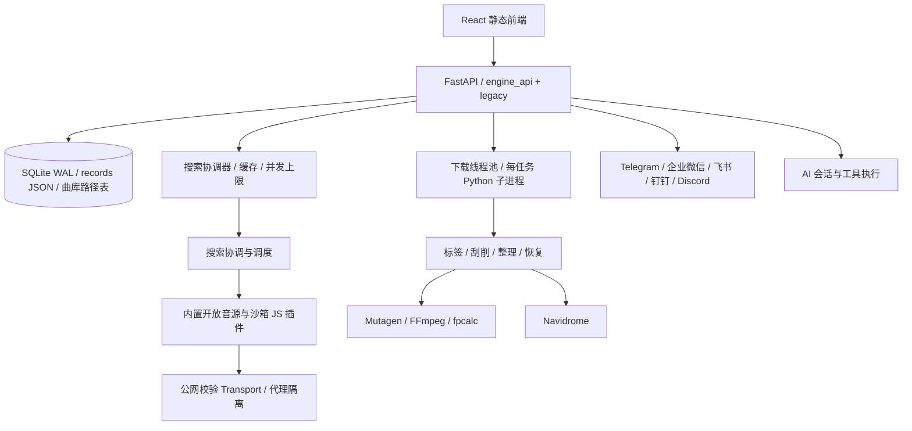

# MeloKeep Go 重构可行性与实施方案

分析日期：2026-11-14。基线：`c17cf18d4edb75fb3c0aa9f4be7d24e6aca87f09`。

本次通过 `git ls-remote origin HEAD` 确认 GitHub HEAD 与本地提交一致，分析开始时工作区干净。本文基于源码、测试、CI、部署文件与已有验收资料；未启动用户服务、未访问用户凭据、未执行真实音源下载或外部写入。

## 1. 结论与范围

**可行，建议把产品后端迁移到 Go，但采用逐模块替换，并以性能基线和行为等价作为发布门槛。**

收益最可能来自：减少 Python 搜索/下载子进程及导入成本、消除文件轮询 IPC、复用公网 HTTP 连接、减少逐条持久化、把曲库全量扫描改成索引查询。Go 本身无法改善外部音源限流、地区限制、模型响应时间、磁盘速度或 FFmpeg 的编码计算量。

推荐的最终产品形态：

- React / TypeScript 前端保留，由 Go 提供构建后的静态文件。
- HTTP API、音源调度、原生音源适配、下载、数据库、文件操作事务、机器人、AI 编排均由 Go 承担。
- 保留 FFmpeg、fpcalc、官方 telegram-bot-api 等成熟外部程序，按功能启动。
- 音频标签写入通过受控 Mutagen helper 按需运行，不作为常驻第二套后端；是否进一步替换为纯 Go / TagLib 方案由后续格式验证决定。
- 继续使用 SQLite 和单实例部署，不增加 Redis、消息队列、微服务或新的前端框架。

“全部自有后端业务用 Go”与“整个运行环境不含 Python”是不同目标。前者已在当前服务落地；后者仅要求评估是否完全替代 Mutagen 的多容器写标签路径，不影响主服务的单一 Go 二进制进程架构。

前端无需改成 Go/WASM。现有 Docker 中 Node 仅用于构建，生产运行阶段没有常驻 Node 服务；重写前端不会直接降低服务端常驻资源。

## 2. 项目规模与现状

按 Git 已跟踪文件统计，行数包含空行和注释：

| 范围 | 文件数 | 行数 / 数量 |
| --- | ---: | ---: |
| 后端 Python，排除 tests、tools | 30 | 19,787 行 |
| 后端测试 Python，含 legacy/tests | 37 | 11,993 行 |
| frontend/src 下 TS、TSX、CSS | 32 | 20,796 行 |
| 后端静态定义的 test_* 函数 | — | 424 个；不等于参数化后的测试用例数 |
| HTTP 路由装饰器 | — | 131 处；含被覆盖的 legacy 路由及相对路径，不等于有效公开端点数 |
| 内置开放音源 ID | — | 7 个（另支持用户自装沙箱 JS 插件） |

几个主要文件：`native_providers.py` 3,292 行，`native_site_providers.py` 2,281 行，`native_extra_providers.py` 1,916 行，`bot_notifications.py` 1,805 行，`engine_api.py` 1,686 行，`library_pipeline.py` 1,458 行，`legacy/app.py` 1,374 行，`ai_agent.py` 935 行。工作量集中在协议行为和状态管理，不在 HTTP 路由语法。

### 2.1 当前运行架构



`app.py` 从 `legacy/app.py` 创建应用，再由 `engine_api.install()` 在前面插入新路由，同时继续复用旧配置、鉴权、播放和维护逻辑。不能只迁移新 API 文件而忽略 legacy。

### 2.2 功能与迁移边界

| 模块 | 当前职责 | Go 迁移策略 | 难度 |
| --- | --- | --- | --- |
| app、launcher、runtime_config、docker-entrypoint | 启动探测、环境变量和历史目录迁移、UID/GID、配置 | Go 启动命令与配置解析；保留历史名称优先级和目录保护 | 中 |
| legacy/app、engine_api | 鉴权、API、搜索 SSE、曲目身份、播放、收藏、歌单、队列 | 冻结有效路由和 JSON 契约，按领域迁移 | 高 |
| search_runtime、engine_worker | 有界搜索、任务合并、缓存、IPC、取消和进程回收 | 原生 Go 调度 | 中高 |
| provider、plugin | 7 个内置开放音源、音质、搜索、解析、歌单与 JS 插件沙箱 | Go 原生实现与 Goja 隔离运行时 | 高 |
| public_http、resumable_download | 公网访问约束、Cookie/代理、重定向、Range | Go Transport + 流式下载；保留安全与续传语义 | 高 |
| song_storage | JSON .song、受限旧 pickle、字节/episodes 兼容 | Go 读 JSON；旧 pickle 由一次性离线工具转换 | 中 |
| local_library | 读取/写入多容器标签、歌词、封面 | 保留受控 Mutagen helper，按需探索纯 Go 解析 | 很高 |
| library_pipeline、library_rules | 预览、匹配、字段锁、模板、发布、备份、回滚、监控 | Go 文件操作事务和索引；保留旧模板语义 | 很高 |
| metadata_scraper、audio_tools | 多源刮削、指纹、解码、去重、转码、CUE | Go HTTP/调度；继续调用 FFmpeg/fpcalc | 中高 |
| navidrome | Subsonic 访问、浏览/播放/歌单/扫描、删除边界 | Go HTTP 客户端；保留能力检查和凭据隐藏 | 中 |
| bot_notifications、bot_channels、telegram_local | 五渠道、签名/加密、私聊/白名单、通知重试和文件交付 | 统一业务调用；渠道分别实现；保留持久队列 | 高 |
| ai_agent、project_operations | Chat Completions/Responses、图片、工具发现、执行、恢复 | Go 编排 + 明确操作目录；复用业务校验 | 高 |
| 前端 | 搜索、播放器、曲库、整理、机器人和 AI 设置 | 主体保留；曲库分页/事件推送时做必要适配 | 低至中 |
| tests、tools、CI、Docker | 协议回归、离线测试、实网验收、双架构发布 | 保留基准 Python 版本作对照，补 Go 和跨语言契约测试 | 中高 |

### 2.3 现有能力边界必须保留

内置数据源明确限定为 7 个开放许可或官方公开试听源（Audius、FMA、CCMixter、OpenGameArt、Wikimedia Commons、Jamendo、iTunes 30 秒官方试听），所有试听片段均显式标明 `PreviewOnly: true`；更多外部来源由用户自行通过中立的 `Provider Plugin API v1` JavaScript 沙箱插件扩展，插件访问范围严格受限于公网 SSRF 防护与管理员白名单。

## 3. 资源开销分析

以下是源码确认的机制及待测影响，不是已经完成的性能归因。

### 3.1 搜索与下载进程

- `engine_api.py:388` 附近创建歌单导入用的单 worker ProcessPoolExecutor；常规音源搜索另外使用 SearchWorkers。
- 搜索活动槽默认 4，环境配置上限 6；SearchWorkers 默认最多保留 2 个空闲 worker，20 秒后释放。保留池不是整个进程树的硬上限。
- 搜索请求通过 pickle 文件传参、结果文件/增量文件返回；主进程每 100 ms 轮询。
- 下载线程池默认 2、最大 4；活动下载会另起 Python worker，进度文件每 250 ms 读取，落库已节流到约 2 秒一次。
- 普通 HTTP 请求和解析迁到 Go goroutine 后，可以减少解释器导入、对象复制、IPC 文件与进程内存。
- 当前进程隔离有实际用途：能够终止不可取消的线程/提取器。Go context 只是协作式取消，不能强杀卡住的 goroutine；第三方库或 native 调用仍需 helper 进程与进程树清理。

已有优化应继承：30 秒搜索缓存、8 MiB 搜索缓存预算、相同请求合并、候选延迟解析、32 MiB 曲目缓存预算、worker 复用。缓存预算基于序列化字节，不能等同于进程 RSS 上限。当前 `.env.example` 中 `MELOKEEP_LAZY_SEARCH=0`；验收要分别测现有默认模式和可选 lazy 模式，不能通过减少解析工作冒充同等功能提速。

### 3.2 公网请求连接复用

`public_http.request()` 对每次请求、每次重定向构建新的 requests/curl 传输会话，并在响应完成后关闭。外层 provider session 保留部分状态，但不能据此推断底层跨请求 TCP/TLS 连接持续复用。

改为按代理、目标域、TLS/指纹策略等隔离的长期 Go Transport，认证 Cookie 按账号隔离。保持每次新连接的 DNS 校验和 IP 固定、原始 Host/SNI、重定向复验以及跨站敏感头清理。旧连接对应的是先前已校验目标，不能把连接池复用实现成绕过新目标校验。代理模式要验证实际连接目标，不能只在本机解析后让代理重新解析未校验域名。

这是值得最先做对照实验的优化，也可以在 Python 中改进；它带来的收益不能全部归功于 Go 语言。

### 3.3 SQLite 与曲目持久化

`engine_api.py:157` 起使用 SQLite WAL、一个共享连接和 RLock。`put()` 每次写入后 commit；`values(kind)` 先获取最多 10,000 条 JSON，多个调用再在内存筛选/排序。

`remember()` 需要 JSON 序列化、指纹计算、`.song` 文件保存及数据库记录。已有指纹去重，仍需测量新搜索结果的写入次数和耗时。

建议分两步：先兼容现有 records schema，使用短事务与适当批量提交；再把需要检索和分页的曲库、下载、任务索引结构化。低频配置继续 JSON。不要在第一次 Go 替换时同时重做所有存储。

### 3.4 曲库浏览

`library_pipeline.scan()` 使用 os.walk；`GET /api/files` 遍历曲库、读取元数据、更新资源映射并返回完整列表。`read_metadata` 已有 4096 项 LRU，命中后仍有目录遍历、stat、路径/数据库处理及大 JSON 返回。

大曲库的核心改造是“后台增量索引 + SQL 筛选分页”。首次扫描依然需要读目录和文件，后续按路径、mtime_ns、size 识别变化；写入、移动、删除主动更新索引，周期扫描修复漂移。NAS/SMB/NFS 上不能只依赖文件系统事件。索引完成时间和查询时间分别统计。

分页会改变前端行为，应新增带分页的兼容入口并迁移前端调用，不直接让原 `/api/files` 少返回数据。

### 3.5 文件操作、HLS 与外部进程

- 标签写入和整理为可恢复性使用完整文件备份/工作副本，磁盘 I/O 不会因换语言消失。默认保留 7 天备份是磁盘容量问题，不是 RAM 泄漏。
- HLS 当前逐段下载，单段内容在内存中解密后写文件。可考虑小规模并发和有界缓冲，但需保存分段顺序、密钥、IV、MAP、BYTERANGE 行为，先以正确性为门槛。
- FFmpeg 完整解码、转码、PCM 去重和 fpcalc 的 CPU 开销保留。用单独信号量控制，不能随 goroutine 数量无限启动。
- 官方 Telegram 本地 Bot API 只在启用时运行。它被打包进镜像影响体积，与是否常驻内存应分开统计。
- 下载已采用流式 Range 传输，不应以“当前整首歌曲都缓存在内存”作为重构理由。历史 SongInfo 仍允许 downloaded_contents，应在新模型中把大字节与元数据分离。

### 3.6 前端与外部服务

搜索已有 SSE，下载、日志、AI、整理任务仍存在不同周期轮询。可在后续统一部分任务事件，或改用增量游标和页面不可见时退避；不是第一阶段重构前提。大曲库分页也会减少浏览器内存。

AI 使用远程模型；换 Go 主要改善连接、队列、状态保存，模型生成时间不会显著缩短。搜索吞吐、下载速度仍受上游和网络限制。

## 4. 技术方案

### 4.1 单体结构

```text
cmd/melokeep/          服务启动、维护/迁移子命令
internal/httpapi/      路由、鉴权、SSE、媒体响应、静态资源
internal/search/       搜索调度、请求合并、有界缓存
internal/provider/     音源模型、注册表、逐平台实现
internal/transport/    公网请求、DNS/代理/TLS/重定向规则
internal/download/     队列、续传、HLS、任务恢复
internal/store/        SQLite、schema 版本、兼容读写
internal/library/      索引、刮削、规则、文件事务和恢复
internal/media/        标签适配和 FFmpeg/fpcalc 管理
internal/navidrome/    Navidrome 集成
internal/bot/          渠道接收、通知、文件交付
internal/agent/        模型协议、会话、工具操作和恢复
frontend/             保留现有前端
```

这是按职责划分的包，不是独立服务；只在实际迁移时增加所需代码。

| 领域 | 建议 | 取舍与验证 |
| --- | --- | --- |
| Go 版本 | 开工时选择仍受支持的稳定版并锁定 | 不在规划阶段写死未经验证的未来版本 |
| HTTP | 标准库 net/http、ServeMux、encoding/json | 足够承担现有 API；补齐校验、错误结构、SSE flush、媒体 Range |
| 静态文件 | go:embed | Node 保留在构建阶段；发布单个核心服务可执行文件 |
| 并发 | context、明确的信号量/有界队列 | 默认搜索 4、下载 2、媒体工具 1、库写操作 1，先与旧版同工作量比较 |
| SQLite | database/sql；优先验证 modernc.org/sqlite | 便于 CGO=0；若测得明显劣势再对照 mattn/go-sqlite3，不宣称纯 Go 驱动一定更快 |
| 数据访问 | 显式 SQL、版本化迁移 | 不引入 ORM；写事务短小，按负载配置有限读连接及 busy timeout |
| HTTP 重用 | 标准 Transport + 按安全策略隔离的池 | 限定连接数、header/body 大小、idle timeout 和重试预算 |
| HTML/协议 | 标准库 crypto + 必要 HTML parser | 复用成熟解析器；保持平台签名字节、编码、压缩及 Cookie 语义 |
| 可观测性 | slog、受限 pprof、任务阶段耗时 | 指标先用于基准和诊断，不先引入独立监控系统 |

这些第三方库是待验证候选，本次未完成它们的维护状态、许可证或跨平台兼容性审计。

### 4.2 音源模型与迁移顺序

区分候选 Track、已解析的 MediaVariant 和持久任务。稳定的曲目 ID 与临时 URL 分离；凭据由请求上下文加载，不能进入浏览器公开 DTO。旧 ID 迁入后保持不变，新 ID 规则需有版本和映射。

Provider 最小职责为 Search、Resolve，以及可选 Playlist；并非所有源都实现所有能力。能力表分别声明搜索、完整音频/试听、音质、歌单、歌词、地区/账号要求、实现状态、最近在线验收状态。以有界增量回调输出搜索结果，确保取消、慢消费者、重试和事件重放语义明确。

顺序建议：

1. 内置开放与试听源（Audius、FMA、CCMixter、OpenGameArt、Wikimedia Commons、Jamendo、iTunes）：建立主工作流，验收搜索、分页、试听标记、解析、下载与能力声明。
2. JS 插件沙箱运行时（Goja）：实现 `Provider Plugin API v1`、15s 硬超时中断、公网 SSRF 防护与凭据隔离。
3. 资料源集成：MusicBrainz、Cover Art Archive、iTunes 目录、AcoustID 指纹与 LRCLIB 歌词，并允许合法插件扩展 `metadata` 与 `lyrics`。

### 4.3 关键技术验证

**标签写入。** Mutagen 当前覆盖 MP3、FLAC、M4A、WAV、Ogg、Opus、WMA，且有真实音频回归。纯 Go 读取标签库不代表能等价写回。保留按需运行的受控 Mutagen NDJSON helper，确保 Go 核心保持无 CGO，并提供故障隔离。

标签验收需包含 17 个文字字段、track/disc total、歌词、封面、未知标签保留/清空、不同字符编码、损坏文件及音频内容不变。直接用 FFmpeg remux 取代所有标签编辑会改变容器/标签语义，不能作为默认等价方案。

**HTTP 连接复用与安全传输。** 所有公网数据源及插件 HTTP 请求统一经由安全 Transport 发出，保持 DNS 校验与 IP 固定、原始 Host/SNI、重定向复验、跨站敏感头剥离以及按代理/修订版本隔离连接池。

**模板语言。** library_rules 支持有限的 Python 表达式语义，包括条件、and/or/not、字符串方法、下标、int/str、zfill、拼音首字母和繁简转换。Go template/CEL 的语法不同，直接替换会破坏已有用户规则。保留限定语法并以旧实现作为 golden oracle；错误行为、Unicode、负索引、长度/整数上限都需要用例。若未来引入新语法，必须保留旧版本解析器和显式迁移。

### 4.4 AI 与机器人不是附属功能

project_operations 依赖 FastAPI 路由反射和 OpenAPI schema，并通过内部 ASGI 调用复用已有校验。Go 标准库不会自动提供这套能力。

建立明确的 Operation 目录，记录方法、路径、参数/schema、读写权限和执行入口，让 HTTP 与 AI 使用同一套输入校验和业务函数。可以采用 schema 生成工具，但不为此搭建庞大的插件系统。保持字段隐藏、配置密钥合并、禁止任意 URL/命令、媒体/鉴权/递归 AI 接口排除规则。

保留会话计划、安全等待检查点、停止语义、重启后核对，以及不自动重放中断写操作。停止助手不能意外取消它已创建的下载。

机器人逐渠道验证回调验签、时间窗、去重、白名单、私聊限制、用户/渠道隔离、通知重试、任务归属和文件大小回退。通知具有外部副作用，影子对照只能记录待发送内容，不能双发。

## 5. 数据兼容、文件安全与回滚

### 5.1 第一版 Go 必须能读懂的旧状态

- config.json、.env、MELOKEEP_* 与旧 MELODOCK_* 的配置优先级；保留未识别的源配置，不静默丢字段。
- SQLite records、library_assets、library_paths；全部收藏、歌单、队列、下载、整理任务、AI、机器人记录。
- `.song` JSON，包括 raw_data、episodes、受支持字节编码、保存路径；历史 pickle 仅由受限离线转换工具读取。
- `.part`、`.part.json`、下载任务状态、已过期 URL；不可信续传校验器缺失时重新下载，不能追加错误字节。
- `.partial`、`.processing`、`.melokeep-history` 及文件操作日志；资产稳定 ID、旧路径映射、签名链接需要保留。
- 用户权限、密钥和文件系统权限；登录内存会话可在切换后要求重新登录，须写入升级说明。

初期兼容原表；针对曲库增加索引列/表、针对任务增加必要查询索引。SQLite migration 使用单调版本号、事务、完整性检查，禁止两个版本同时写同一数据库/音乐目录。

### 5.2 切换过程

1. 固定旧版本镜像 digest/提交，导出不含秘密的配置清单和任务统计。
2. 停止新任务，暂停下载，等待当前文件修改完成或回滚；停止旧服务。
3. 一致性备份 SQLite、配置、缓存、文件操作日志和必要音乐/历史目录。使用 SQLite backup API 或在确认干净关闭后复制，不能只拷贝仍活动的 DB 主文件忽略 WAL。
4. 对备份副本运行 dry-run 迁移；核对资产 ID、路径、歌单引用、任务总数及可恢复记录。先迁旧 pickle，再启动 Go。
5. Go 使用原端口 8765 和挂载目录；先只读验收，再开启写任务。过程只能有一个任务调度器/写入者。
6. 升级早期优先使用向后兼容的 schema 和记录；出现问题停 Go，核对升级后发生的文件/任务变化，再恢复匹配的数据库和文件快照并启动固定旧版。

仅切回旧镜像不能保证回滚：如果 Go 已改文件但只恢复旧数据库，会破坏路径和历史一致性。完整回滚必须演练，不能以“备份 DB”代替。

迁移期如果需要 Python 兼容能力，helper 不持有主数据库写权；只接收任务输入、返回结果/临时文件，由 Go 统一提交任务状态和发布文件。

### 5.3 文件事务必须保留

继续使用预览快照、文件版本检查、每资产锁、原件/附属文件备份、同目录临时文件、发布操作日志、原子替换、冲突拒绝和重启恢复。SQLite 事务不能覆盖文件系统事务，需靠持久操作日志进行协调。

覆盖 Windows 路径大小写、保留名、符号链接/reparse point、硬链接支持、跨卷移动和 NAS 权限。当前不支持硬链接的文件系统会拒绝部分发布；Go 版可继续明确拒绝，若增加降级路径要单独验证，不在迁移中默默降低保护。

## 6. 实施阶段与估算

以下是熟悉 Go、Python、媒体协议的一名工程师的**有效人日估算**，包含实现和回归，不含等待真实账号/平台恢复。不是按代码行数精确预测的承诺。按阶段验收，未过门槛不继续扩大替换面。

| 阶段 | 交付物 | 退出条件 | 人日 |
| --- | --- | --- | ---: |
| P0 基线与契约 | 旧版隔离环境、有效 API/OpenAPI、SSE/状态快照、数据样本、性能记录 | 主路径可重复；关键旧测试通过或缺陷有记录 | 3–5 |
| P1 风险样机 | Go 服务/SQLite、一个完整音源、受控 HTTP、标签 helper、提取器/模板验证 | 搜索→播放→下载→写标签→恢复闭环；关键技术可替代 | 5–8 |
| P2 核心替换 | API/鉴权、SSE、内置开放音源、HTTP/HLS、队列/恢复、收藏/歌单 | 旧 UI 主流程可用；内置源行为与取消/恢复通过 | 12–18 |
| P3 曲库与媒体 | 增量索引、分页、刮削、字段锁、模板、整理、监控、恢复、音频工具、Navidrome | 多格式/崩溃/迁移/大曲库回归通过 | 10–16 |
| P4 集成 | 五渠道机器人、持久通知、AI 工具目录、会话恢复 | 权限、去重、交付、AI 中断恢复等价 | 8–12 |
| P5 插件沙箱 | Goja Provider Plugin API v1 运行时、SSRF 白名单、管理接口与示例插件 | 沙箱隔离、15s 硬中断、并发与安全边界验收 | 6–10 |
| P6 发布与收敛 | 双架构镜像、Windows 包、迁移工具、回滚演练、耐久压测 | 功能与资源目标达标，文档/许可清单齐全 | 5–8 |

合计约 **49–77 人日**。P0–P2 累计约 20–31 人日可以形成核心版候选，阶段之间可局部交错。

维持受控 Mutagen helper 负责 7 种音频容器的标签写入可显著降低 C/C++ CGO 跨平台构建风险，保证 Go 核心二进制保持纯净与无 CGO 静态编译。

## 7. 性能基准与验收

### 7.1 当前证据范围

仓库有 `tests/benchmark_search.py`，使用真实 worker/IPC、禁用真实音源搜索来比较新起进程与复用进程；它只取少量样本，适合粗测机制，不足以证明整站资源收益。

本次发现命令环境没有可直接调用的项目 Python/Go；可用的捆绑 Python 缺少 requests、FastAPI、Mutagen 等项目依赖。因此没有运行现有测试或声称它们通过，没有测量 RSS、CPU、实际搜索耗时，也没有安装依赖改动用户环境。P0 应创建隔离运行环境，固定依赖与旧提交后采样。

### 7.2 测量方式

建议主验收在同一台 2 核 / 2 GiB 的 Linux NAS 级设备或固定资源容器，另验 Linux arm64 和 Windows。记录 CPU 型号、磁盘/网络、Go/Python/FFmpeg 版本、配置和数据规模。

- 统计整个进程树：核心服务、搜索/下载 helper、FFmpeg、fpcalc、Telegram Bot API。不能只对比 Go 主进程和 Python 全部子进程。
- Linux 报告 cgroup memory.current/peak 和 RSS/PSS，区分文件页缓存；Windows 记录工作集及私有字节。镜像压缩体积、解包体积、启动时间、内存分别报告。
- 每个非耐久场景至少 30 次，区分冷启动、连接池冷/热、搜索缓存冷/热；报告 p50/p95、错误率、超时率、首结果与全部完成时间。
- 固定同一结果数、音质、解码范围、并发和 lazy 选项；不能靠禁用源、关闭标签写入或省略校验达标。
- 离线录制/本地受控 HTTP fixture 用于稳定比较；在线仅对照平台可用性与端到端体验，不能拿不同时段限流结果推断语言速度。

| 场景 | 工作负载 | 重点指标 |
| --- | --- | --- |
| 空闲 | 无任务 10 分钟，分别开/关机器人 | 进程树 RSS/PSS、CPU、进程/线程数 |
| 搜索 | 内置开放源并发搜索，1/4/8 个并发请求，含重复请求 | 首条/完成 p95、连接/请求数、缓存与合并效果 |
| 解析 | 多音质、过期链接、同曲并发解析 | 正确版本、去重、解析 p95 |
| 下载 | 2/4 个 HTTP 下载、HLS、暂停/续传/取消 | 吞吐、CPU、峰值内存、重试和 Range 正确性 |
| 曲库 | 1k/10k/100k 文件，初扫/无变化/1% 变化 | 扫描时间、热查询 p95、响应大小、索引完整性 |
| 文件处理 | 七种主格式，封面/歌词/文字/恢复 | 解码音频等价、标签正确、I/O、崩溃恢复 |
| AI/机器人 | 假模型流、重发回调、网络错误、重启 | 重复操作/通知数、队列界限、状态一致性 |
| 耐久 | 24 小时搜索/取消/下载/索引混合 | 稳态内存、goroutine/FD/临时文件不持续累积 |

### 7.3 建议目标，需由 P0/P1 校准

下列数字是立项目标，不是已取得或保证取得的收益：

| 指标 | 第一轮目标 |
| --- | --- |
| 相同功能开关下空闲进程树内存 | 比 Python 基线下降至少 30%；若旧版本已低于合理预算，评估绝对节省是否值得迁移 |
| 原生并发搜索期间峰值内存 | 比基线下降至少 40% |
| 受控 fixture 下搜索编排/IPC 开销 p95 | 比基线下降至少 50%；另报不扣网络的端到端耗时 |
| 在线搜索正确性/错误率 | 不因迁移退化；异常区分协议、账号、地区与网络 |
| 在线/本地稳定 HTTP 下载吞吐 | 在受控重复测量中不低于基线 95%，并减少进程开销 |
| 索引完成后的 100k 曲库分页 | 100 条/页的代表性过滤查询 p95 < 200 ms；模糊全文检索另测，不含首次扫描 |
| 不可变数据和文件安全 | 迁移无丢失，错误续传/重复发布/未授权操作为零 |
| 耐久 | 预热后无持续线性增长，取消后资源在定义超时内回收 |

若 P1 没有实质资源收益，应先优化连接池/索引/落库方式并重新对比，不以“已经开始重写”为理由继续扩大范围。

## 8. 测试与发布门槛

现有测试包含大量 Python 内部对象/monkeypatch，不能直接当作 Go 测试运行。把其中的协议 fixture、输入输出、状态边界抽成语言无关样本；旧 Python 版本充当行为对照。已有 live 工具与历史验收报告继续作为输入，不把旧报告当新版本证明。

关键测试集：

1. API 契约：有效路由优先级、字段缺失/null、错误状态和 detail、配置隐藏与保留、旧别名、Cookie 和 `X-MeloKeep-Request`。
2. 搜索与播放：多源增量、SSE id/Last-Event-ID、断线宽限期、取消和复用、相同请求合并、音质/试听声明、媒体 Range 和凭据隔离。
3. 下载协议：200/206/416、If-Range/ETag、Content-Range 不匹配、压缩响应、断流、URL 过期、HLS AES-128/MAP/BYTERANGE、任务恢复。
4. 网络边界：DNS 重绑定、IPv4/IPv6、每跳重定向、公网与允许私网的 Navidrome/本地 Telegram 分离、代理实际目标、Cookie/Authorization 不串源。
5. 文件事务：预览后文件变化、标签/封面/歌词/附属文件、目标重名、跨卷/符号链接、操作每个持久阶段强制退出再启动恢复。
6. AI/机器人：读写权限、消息去重、签名重放、用户归属、模型工具参数、停止/重启不重复写入、通知重试不双发。
7. 兼容：旧 SQLite/配置/.song/受限 pickle/part/history 样本、稳定 ID/路径引用、模板表达式与中文处理 golden tests。

CI 保留现有前端格式、单元与 Playwright 检查；新增 Go test、关键并发包 race 检查以及 URL/模板/Range/HLS/路径解析 fuzz。Linux amd64、arm64、Windows 分别验证依赖组合和文件行为。

发布阶段先提供固定版本的 Go preview，经过迁移/回滚及耐久门槛后再替换默认镜像。可提供 core 与兼容功能完整包，清楚说明后者保留哪些 helper；若移除某 helper 会丢失已实现能力，不能把 core 包标为全功能等价。

遵循根目录 `LICENSE`（MIT）与 `NOTICE.md` 第三方组件声明。

## 9. 核心执行路径

优先完成 P0 + P1：冻结接口契约，建立隔离基准；完成内置开放源的 Go 搜索/解析/下载闭环；验证连接复用、多格式标签与数据迁移恢复演练。

## 10. 主要依据

- 架构与协议：Go `internal/` 核心模块、`docs/provider-plugin-spec.md`。
- 文档与规范：`docs/music-library.md`、`docs/ai-assistant.md`、`docs/configuration.md`、`NOTICE.md`。
- 验证与部署：`tools/benchmark_go.py`、`frontend/tests/`、`Dockerfile`、`.github/workflows/docker-publish.yml`。
